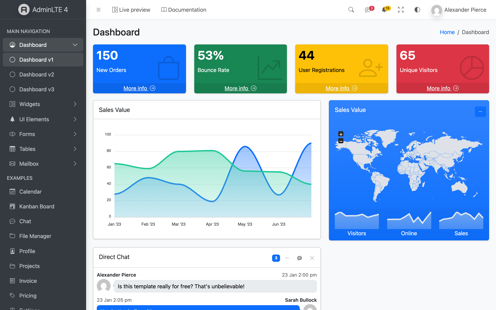

<div align="center">

# AdminLTE 4 for Symfony

**Official [AdminLTE 4](https://adminlte.io) integration for Symfony** — Bootstrap 5.3, AssetMapper, Twig Components, a config-driven sidebar menu, SSR-safe dark mode, and an optional theme for EasyAdmin.

[](https://packagist.org/packages/colorlibhq/adminlte-symfony)
[](https://symfony.com)
[](https://php.net)
[](https://getbootstrap.com)
[](LICENSE)

**🔗 [Live demo](https://adminlte-symfony.pages.dev)** · **📚 [Documentation](https://docs.adminlte.io/symfony/introduction)**

</div>

---

### AdminLTE everywhere

<!-- ADMINLTE-ECOSYSTEM:START -->
<div align="center">
  <a href="https://github.com/ColorlibHQ/AdminLTE"></a>
  <a href="https://github.com/ColorlibHQ/adminlte-react"></a>
  <a href="https://github.com/ColorlibHQ/adminlte-react"></a>
  <a href="https://github.com/ColorlibHQ/adminlte-vue"></a>
  <a href="https://github.com/ColorlibHQ/adminlte-vue"></a>
  <a href="https://github.com/ColorlibHQ/adminlte-angular"></a>
  <a href="https://github.com/ColorlibHQ/adminlte-laravel"></a>
  <a href="https://github.com/ColorlibHQ/adminlte-symfony"></a>
  <a href="https://github.com/ColorlibHQ/adminlte-django"></a>
  <a href="https://github.com/ColorlibHQ/adminlte-aspnet"></a>
  <a href="https://github.com/ColorlibHQ/adminlte-drupal"></a>
  <a href="https://docs.adminlte.io"></a>
</div>
<!-- ADMINLTE-ECOSYSTEM:END -->

<p align="center">
  <a href="https://adminlte-symfony.pages.dev"></a>
</p>


---

## Features

- 🧩 **Twig Components** — `<twig:Adminlte:Card>`, `<twig:Adminlte:SmallBox>`, … typed, documented, slot-aware.
- 🧭 **Config-driven sidebar menu** — one array in `config/packages/adminlte.yaml`, with automatic active-route detection and per-item security (`permission`).
- 🌗 **SSR-safe dark mode** — Bootstrap 5.3 `data-bs-theme`, set before first paint (no flash), persisted to `localStorage`, follows the OS while on `auto`.
- ⚡ **AssetMapper-first** — no Webpack Encore, no Node build required. CDN works out of the box; AssetMapper is the production path.
- 🎛️ **Optional EasyAdmin theme** — layer AdminLTE styling onto your EasyAdmin backend.
- 🧱 **Symfony-native** — `AbstractBundle`, autoconfigured services, PHP 8.4, strict types, PHPStan + php-cs-fixer.

## Requirements

| | |
|---|---|
| PHP | 8.4+ |
| Symfony | 8.1+ (also 7.4 LTS once stabilised) |
| EasyAdmin *(optional)* | 5.1+ |

## Installation

```bash
composer require colorlibhq/adminlte-symfony
```

With Symfony Flex the bundle is registered automatically. Otherwise add it to `config/bundles.php`:

```php
return [
    // ...
    ColorlibHQ\AdminLteBundle\AdminLteBundle::class => ['all' => true],
];
```

## Configuration

Create `config/packages/admin_lte.yaml` (Symfony underscores the bundle name, so the config key is `admin_lte`):

```yaml
admin_lte:
    title: 'My Admin'
    title_short: 'MA'
    color_mode: auto            # light | dark | auto
    dashboard_route: app_dashboard

    logo:
        text: '<b>My</b>Admin'
        image: '/build/logo.png'  # optional

    layout:
        fixed_sidebar: true
        sidebar_mini: true
        sidebar_collapsed: false

    footer:
        copyright: '© 2026 My Company'
        version: 'v1.0.0'

    menu:
        - { label: 'Dashboard', route: 'app_dashboard', icon: 'bi bi-speedometer2' }
        - { header: 'MANAGEMENT' }
        - label: 'Users'
          icon: 'bi bi-people'
          permission: 'ROLE_ADMIN'      # hidden unless granted (needs symfony/security-bundle)
          children:
              - { label: 'All users', route: 'app_user_index' }
              - { label: 'Create', route: 'app_user_new', badge: 'new', badge_class: 'text-bg-success' }
        - { label: 'Documentation', url: 'https://adminlte.io', icon: 'bi bi-book', target: '_blank' }
```

**Menu item keys:** `label`, `header`, `route`, `route_params`, `url`, `target`, `icon`, `badge`, `badge_class`, `permission`, `children`.

## Usage

Extend the layout from any page (this is the Symfony-idiomatic equivalent of the other ports' `DashboardLayout`):

```twig


Dashboard


    <div class="row">
        <div class="col-lg-3 col-6">
            <twig:Adminlte:SmallBox title="150" text="New Orders" variant="primary" icon="bi bi-bag" url="#" />
        </div>
    </div>

    <twig:Adminlte:Card title="Welcome" icon="bi bi-stars" variant="primary" outline collapsible>
        Built with AdminLTE 4 Twig Components.
    </twig:Adminlte:Card>

```

A complete example lives in [`templates/demo/dashboard.html.twig`](templates/demo/dashboard.html.twig). Wire it up:

```php
#[Route('/admin', name: 'app_dashboard')]
public function dashboard(): Response
{
    return $this->render('@AdminLte/demo/dashboard.html.twig');
}
```

### Components (35+)

**Layout** — `Sidebar`, `SidebarNavItem` *(recursive)*, `Topbar`, `Footer`, `ColorModeToggle`. The dashboard layout itself is ``.

**Widgets** — `Card`, `SmallBox`, `InfoBox`, `Alert`, `Callout`, `Progress`, `ProgressGroup`, `Timeline` + `TimelineItem`, `ProfileCard`, `DescriptionBlock`, `Breadcrumb`, `Ratings`, `Toast`, `Modal`, `Accordion` + `AccordionItem`, `Tabs`, `NavNotifications`, `NavMessages`, `NavTasks`, `CommandPalette` (⌘K).

**Forms** — `Button`, `Input`, `Select`, `Textarea`, `InputSwitch`, `InputColor`, `InputFile`.

Every component is a Twig Component:

```twig
<twig:Adminlte:Card title="Sales" icon="bi bi-graph-up" variant="primary" collapsible>…</twig:Adminlte:Card>
<twig:Adminlte:SmallBox title="150" text="New orders" icon="bi bi-bag" url="#" />
<twig:Adminlte:Timeline><twig:Adminlte:TimelineItem icon="bi bi-bell" time="3m" header="Ping" /></twig:Adminlte:Timeline>
<twig:Adminlte:CommandPalette />  {# ⌘K palette, indexed from your sidebar menu #}
```

This matches the component inventory of the Vue/React ports. A few heavy plugin wrappers (charts, datatables, rich editors) remain optional add-ons.

## Dark mode

The `<head>` script in [`_color_mode_script.html.twig`](templates/components/layout/_color_mode_script.html.twig) sets `data-bs-theme` **before the body paints** (no flash), persists the choice to `localStorage`, and tracks the OS preference while on `auto`. `<twig:Adminlte:ColorModeToggle />` flips it via the exposed `window.adminlteToggleColorMode()`. A Stimulus alternative ships in `assets/controllers/color-mode_controller.js`.

## Production assets (AssetMapper)

The CDN links in the layout's `stylesheets`/`javascripts` blocks make the bundle work with zero config. For production, serve assets locally:

```bash
php bin/console importmap:require bootstrap admin-lte bootstrap-icons/font/bootstrap-icons.min.css
```

```js
// assets/app.js
import '@colorlibhq/adminlte-symfony/adminlte.js'; // Bootstrap + AdminLTE behaviour
```

Then override the layout blocks in your base template to emit `{{ importmap('app') }}` instead of the CDN tags.

## EasyAdmin theme

Layer AdminLTE onto an existing [EasyAdmin](https://github.com/EasyCorp/EasyAdminBundle) backend. Either copy the shipped override into your app:

```
templates/bundles/EasyAdminBundle/layout.html.twig   ←  copy from this bundle
```

…or load the assets from your `DashboardController`:

```php
public function configureAssets(): Assets
{
    return Assets::new()
        ->addCssFile('https://cdn.jsdelivr.net/npm/admin-lte@4.0.2/dist/css/adminlte.min.css')
        ->addJsFile('https://cdn.jsdelivr.net/npm/admin-lte@4.0.2/dist/js/adminlte.min.js');
}
```

> **Note:** this is an initial integration that applies AdminLTE styling to EasyAdmin's own layout. A fully restructured AdminLTE shell (sidebar/topbar/config menu) for EasyAdmin is being rolled out incrementally.

## Development

```bash
composer install
composer check   # php-cs-fixer (lint) + phpstan + phpunit
```

## License

[MIT](LICENSE) © Colorlib & AdminLTE contributors.
